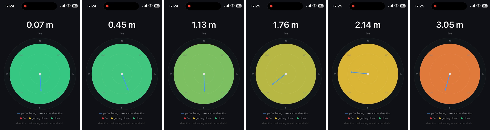
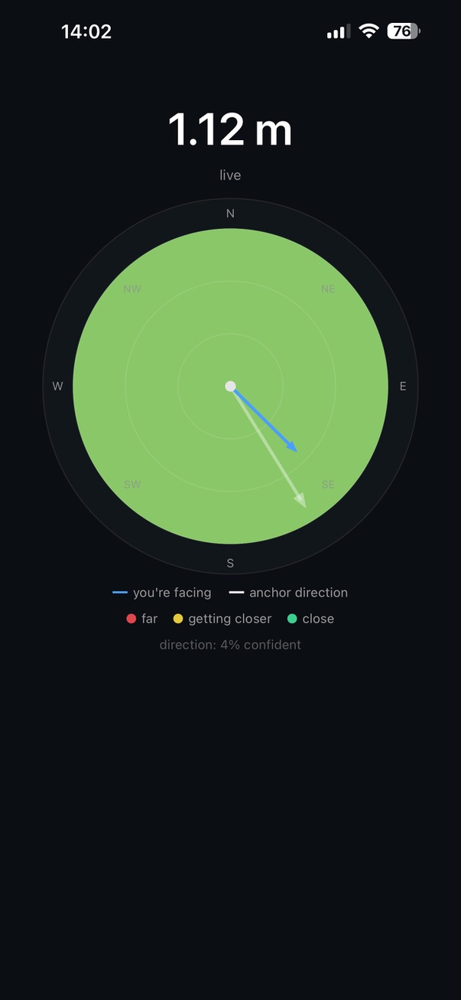
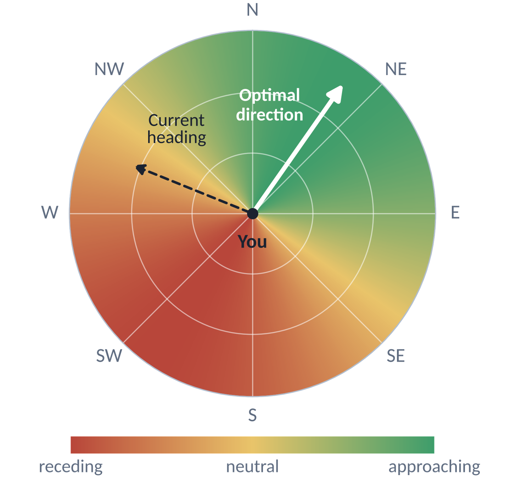
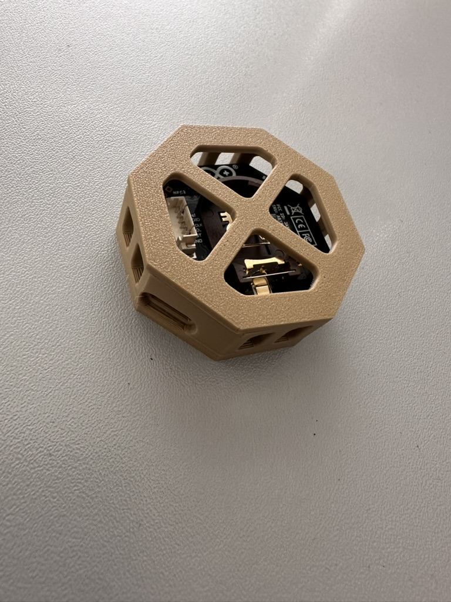
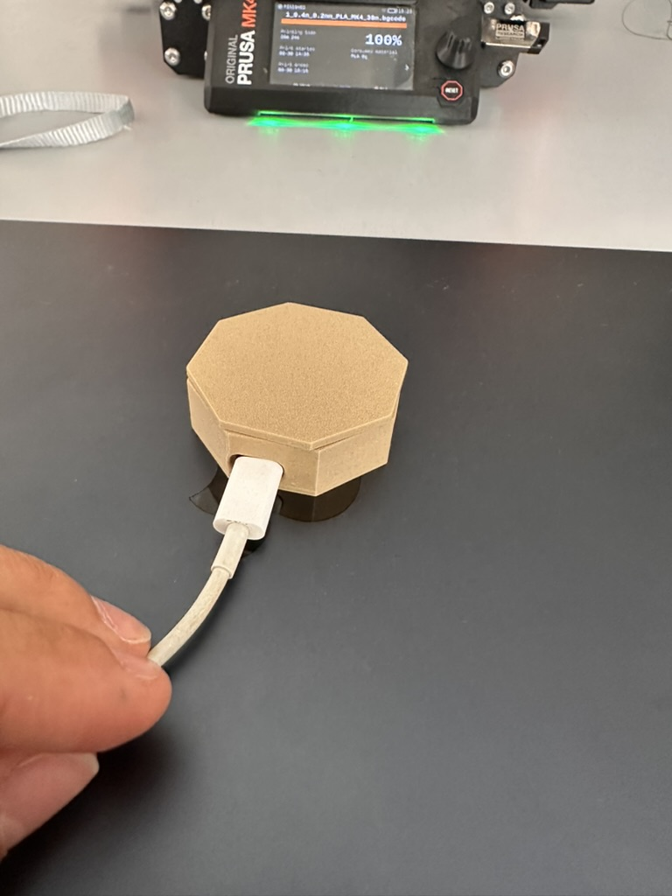

# UWB Stella-Shield indoor positioning

Firmware and phone apps for a small ultra-wideband (UWB) guidance system. A user carries an Arduino Stella tag and is guided towards a stationary anchor, an Arduino Portenta C33 with a Portenta UWB Shield. The tag measures its distance to the anchor by double-sided two-way ranging (DS-TWR) and sends it over Bluetooth Low Energy to an iOS or Android app, which combines it with the phone heading in a radar display.



```
[Shield]  <-- DS-TWR ranging -->  [Stella]  -- BLE notify -->  [phone app]
 stationary anchor,               carried tag,                 iOS (SwiftUI) or
 UWB only                         UWB + BLE                    Android (Jetpack Compose)
```

The 3D-printable enclosures for both boards are in a separate repository: [uwb-stella-shield-enclosures](https://github.com/Raulm33/uwb-stella-shield-enclosures).

## Repository layout

```
.
├── firmware/
│   ├── stella_ble_tracker/    Stella: DS-TWR initiator + BLE peripheral
│   └── shield_controlee/      Shield: DS-TWR responder
├── ios/                       Xcode project (UWBFinder)
├── android/UWBFinderAndroid/  Android Studio project, port of the iOS app
└── docs/                      photos, app screenshots, demo video, concept figure
```

## Hardware

| Node | Board | UWB chip | Role |
|---|---|---|---|
| Stella | Arduino Stella (ABX00131), nRF52840 | NXP SR040 | Tag, ranging initiator (`UWBTracker`), BLE peripheral |
| Shield | Arduino Portenta C33 (ABX00074) + Portenta UWB Shield (ASX00074) | NXP SR150 | Anchor, ranging responder (`UWBRangingControlee`) |

The Shield has no data link of its own. Wi-Fi and UWB do not work together on the Portenta C33: with both active, UWB calls fail with `uwb_bus_io_irq_wait` semaphore timeouts. All data therefore reach the phone through the BLE radio of Stella.

## Firmware

Both sketches use the same session and fixed short MAC addresses.

| Setting | Value |
|---|---|
| Ranging method | DS-TWR (`METHOD_SEL = 0` on the Shield) |
| Session ID | `0x11223344` |
| Stella address / Shield address | `0x2222` / `0x1111` |
| Stella transmit power | `powerId` 12 (labeled +11 dB on the library's relative scale) |

Libraries, installed through the Arduino Library Manager:

- Stella: `StellaUWB` 1.0.2 and `ArduinoBLE`
- Shield: `PortentaUWBShield` 1.0.2

The UWB libraries are distributed by Truesense as precompiled libraries under their own licenses and are not included here.

Flash `firmware/shield_controlee` on the Portenta C33 and `firmware/stella_ble_tracker` on Stella. With a serial monitor open, Stella prints `UWB ranging started.` and `BLE advertising as 'UWB-Stella'.` Its LED is lit during start-up, off while advertising, and lit while a phone is connected; fast blinking means `BLE.begin()` failed.

### BLE GATT interface

| Item | Value |
|---|---|
| Advertised name | `UWB-Stella` |
| Service UUID | `A1E8F400-EE45-4832-A144-6F3E7F0D6B01` |
| Distance characteristic UUID | `A1E8F401-EE45-4832-A144-6F3E7F0D6B01` |
| Properties | read, notify |
| Format | 32-bit little-endian IEEE 754 float, meters |
| Update period | 120 ms while a phone is connected (about 8 Hz) |

Only valid ranging results (status 0, distance not `0xFFFF`) are sent. The firmware sends the raw distance, without bias correction.

## iOS app

`ios/` holds the Xcode project of UWBFinder (SwiftUI, Core Bluetooth, Core Location). The project was created with Xcode 26.6 and targets iOS 26.5.

1. Open `ios/UWBFinder.xcodeproj` in Xcode.
2. Under Signing & Capabilities, select your own team. The team ID was removed from the published project.
3. Run on an iPhone. BLE and the compass do not work in the Simulator.

The app asks for Bluetooth access and for location access, which Core Location needs for the compass heading.



## Android app

`android/UWBFinderAndroid/` is a Kotlin and Jetpack Compose port of the iOS app, file by file, with the same GATT UUIDs, fusion constants and screen layout. The heading comes from the rotation-vector sensor. Build instructions, permissions and the differences from the iOS app are in its own [README](android/UWBFinderAndroid/README.md).

Status: built with Gradle in Android Studio and launched on an emulator, which showed the radar screen and asked for the Bluetooth permission. It has not yet been tested on a phone with Stella.

## How the guidance works

A single range carries no direction, so the apps infer the direction from the user's movement.

The whole disc is colored by the smoothed distance: green at 0.3 m or less, yellow at the midpoint, red at 4.0 m or more. The blue arrow shows where the phone points, and the screen is redrawn at 60 Hz.

For the direction, headings are grouped into 36 bins of 10°. When the distance has changed by more than 4 cm and the heading by less than 60° since the last accepted sample, the bin of the current heading gets a score proportional to the distance change, positive when the user gets closer. All bins decay slowly. The white arrow points along the weighted circular mean of the bins with positive scores and becomes more opaque as the confidence grows. Until enough movement has been collected, the app shows "calibrating — walk around a bit".

The tuning constants (`nearM`, `farM`, `distSmooth`, `headingSmooth`, `arrowLerp`) are at the top of `RadarModel.swift` and `RadarModel.kt`.



The figure above is the guidance concept from the ISETC 2026 work. The implemented apps color the whole disc by distance rather than by direction sector, and show the estimated direction as the white arrow.

## Demo

[`docs/uwb-stella-shield-demo-720p.mp4`](docs/uwb-stella-shield-demo-720p.mp4) (2 min 12 s, no sound) shows the boards, the printed enclosures and screen recordings of the iOS app.

| | |
|---|---|
|  |  |

## Known limitations

- The distance reaches the phone about 8 times per second, and the fusion accepts a sample only after a change of more than 4 cm, so slow movement gives few direction updates.
- The direction estimate needs the user to move and gives nothing while standing still. The confidence figure is a relative indicator, not a probability.
- The ranging bias (several centimeters with line of sight, larger with the antennas high above the floor or through a wall) is not corrected.
- The link uses no pairing or encryption, the app connects to the first device advertising the service, and the session ID and addresses are fixed, so the system supports one tag and one anchor.
- The iOS app uses true north when available; the Android port uses magnetic north.

## Related work

R. A. Muntean, H. Balta, M. Kovaci, A. Vesa, and V. A. Niță, "Experimental characterization of UWB distance measurement error as a function of transmit power and tag localization using a mobile anchor," presented at the Int. Symp. Electron. Telecommun. (ISETC), Timișoara, Romania, 2026.

## License

The source code is licensed under the MIT License; see [LICENSE](LICENSE). The photos, screenshots, figure and video in `docs/` are licensed under [CC BY 4.0](https://creativecommons.org/licenses/by/4.0/).
